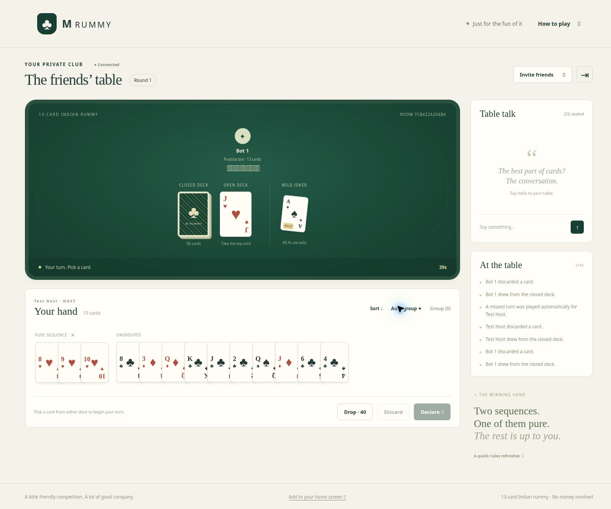

# M Rummy ♣

A private, play-for-fun 13-card Indian rummy app for friends and family. Built for **Hostinger Premium Web Hosting** using PHP 8.2+ and plain HTML/CSS/JavaScript. No Node.js server, database setup, Composer, WebSockets, payment service, or external API is needed on your hosting account.

## What you can do

- Create an invite-only table with a random 12-character code and optional password.
- Play with 2–6 people; add practice bots to empty seats between rounds.
- Share a room link, chat at the table, and return to your seat after refreshing.
- Draw, select cards, sort, manually group, auto-group, discard, drop, and declare.
- Play timed turns with server-side validation and automatic missed-turn handling.
- See round scores, cumulative penalty points, winning groups, and previous rounds.
- Deal rematches with a rotating first player and retained scores.
- Use a phone, tablet, or desktop with the same responsive interface.
- Play in Android Chrome and iPhone/iPad Safari; add an optional home-screen shortcut with dedicated icons and a standalone app window.

This is an original implementation with its own visual identity. The supplied RummyCircle page was used as a gameplay reference, not copied branding or code. There are no deposits, cash prizes, withdrawals, wallets, or monetary stakes.



## Host on your existing Premium plan

Follow **[docs/HOSTINGER.md](docs/HOSTINGER.md)**. Use a dedicated domain or subdomain, with the app at its root (for example `https://rummy.yourdomain.com/`). A subdirectory such as `/games/rummy/` is not supported by the current asset/API URLs.

The GitHub Actions **Check and test** workflow also produces a ready-to-extract **m-rummy-hostinger** artifact containing an upload ZIP. You can build it locally with `python3 tools/package.py`.

## Run locally

Install PHP 8.2 or later. Then, from the repository root:

```sh
RUMMY_DEV=1 php -S 127.0.0.1:3000 -t public public/router.php
```

Open `http://127.0.0.1:3000`. Use two separate browser profiles or one normal and one incognito window to test different players. Tabs in the same browser profile share one player session.

With Node.js 22+ installed, `npm run dev` is a convenience wrapper. No `npm install` is needed; there are no runtime dependencies. `server/config.php` overrides defaults; for local HTTP development omit that file or use a local HTTP origin with `secure_cookies` false. Never use insecure cookies on the hosted site.

## Validate and package

```sh
npm run check
npm test
python3 tools/package.py
```

PHP-only rule/game tests can be run with `php test/run.php`. The HTTP integration test additionally uses Node.js 22+ to launch a temporary PHP server and simulate independent players. It verifies cookie/CSRF protection, player isolation, competing writes, saved-state recovery, chat, drops, and rematches.

## Layout

```text
public/                 Web document root and browser assets
server/                 PHP game, rules, API, and private configuration
test/                   Rules, game, and HTTP tests
tools/                  Local development and upload packaging
docs/HOSTINGER.md        Premium hosting deployment guide
```

Upload **only public/** into the site's public document root. Keep **server/** and runtime **data/** as sibling directories outside that root. The upload ZIP builds this layout for you. Never upload the whole Git repository into `public_html`.

## How the multiplayer server works

The browser asks the PHP API for state every 1.2 seconds while the table is open. Every move is validated on the server. A player receives their own cards and public table details; opponents' hands and the closed deck order are not sent during a round. All hands become public in the finished round result.

State is saved as JSON outside the web root. An exclusive `flock` on a separate lock file serializes each request, and a temporary-file rename saves state atomically. Version checks reject competing/stale moves. Sessions, passwords (hashed), rooms, and scores survive PHP worker restarts. This architecture targets one small friends-and-family server, **not a large public gaming platform** or multiple replicas on shared network storage.

Timers advance when a seated player polls or makes an API request. When everyone closes the app, no PHP process stays running. The next connected request resolves the overdue turn once and starts the next player's timer. There is no background cron requirement.

Sessions last 30 days and rely on the browser's HttpOnly cookie. Use the same browser to reconnect; clearing its cookies creates a different player. There is no email login, cross-device account recovery, or room-owner recovery if the host loses their cookie. Tables inactive for 24 hours expire on a subsequent API request. A lobby host can leave and ownership transfers to another human player. Players leave active tables after the round; dropping allows watching until it finishes.

## Rules used here

- Two 53-card packs; 13 cards per player. One cut indicator is removed from play.
- Cut rank is wild; a printed cut joker makes aces wild.
- Sequences need 3+ same-suit consecutive ranks. Aces are high or low, without wrapping.
- Pure sequences use no joker substitution. A wild-rank card used naturally is allowed.
- Sets contain 3–4 equal ranks with distinct natural suits. All-joker groups are invalid.
- A declaration discards one of 14 cards and covers the remaining 13 exactly, with at least two sequences including one pure sequence. The final discard cannot be the card just picked from the open deck.
- Open-deck jokers cannot be picked. Jokers may be discarded.
- Invalid declarations are rejected without losing cards, ending the turn, or applying a penalty.
- A/K/Q/J: 10 points; numeric cards: face value; jokers: 0. Round loss is capped at 80. Lower cumulative penalty points are better.
- Without a pure sequence, all non-jokers count. With only one sequence, only pure sequences are exempt. With two sequences and a pure one, all valid groups may be exempt. The server minimizes the loss across possible groupings.
- Dropping before completing your first turn costs 20; later drops cost 40. An out-of-turn drop is allowed unless you currently hold a drawn card. The last remaining player wins.
- 60-second turns. Missed turns draw from the closed deck if needed and discard an eligible card. Practice bots use their own hand and the public wild rank only; they do not see the stock order or opponents' hands.

## Operations

Set an optional `create_room_key` in private configuration if you want only people with your shared host code to create tables. Room passwords are separate. Room links are bearer invitations to join, so share privately. No table is listed publicly.

Back up the entire private `data/` directory while the app is idle, together with `server/config.php`. The save files contain live cards and session credentials: never publish them or commit them. Restore the complete state file with restrictive permissions. A corrupt JSON file is not silently reset; restore a backup. For a small private group, periodically remove old backups and monitor disk usage and PHP error logs. Keep Hostinger SSL and PHP security updates enabled.

Do not enable HTML/page caching or CDN caching for `/api/*`. The included service worker never intercepts or caches game API requests; it only provides an offline explanation and its stylesheet. Live play always requires internet. Default security headers are supplied in `.htaccess`. Set the exact HTTPS `app_origin`, and use only the intended host. For TLS redirects use hPanel's Force HTTPS setting.

## Mobile browsers

Open the same hosted HTTPS link in Android Chrome or iPhone/iPad Safari. Touch-select cards and swipe the hand sideways to reach additional groups. Portrait and landscape layouts are supported, including safe-area spacing and form text sized to prevent Safari's input zoom. The footer has **Add to your home screen** instructions. Browser menus and installation wording vary by OS/browser version; no app-store build is necessary.

Keep using the same browser or home-screen app for an existing seat: mobile installations can have their own cookie storage. After locking your phone, changing networks, or backgrounding the page, return to it to reconnect. Server timers may still expire while you're away. This repository was tested with desktop Chrome and narrow phone/tablet browser frames; physical Android and iOS devices still need a smoke test after hosting.
